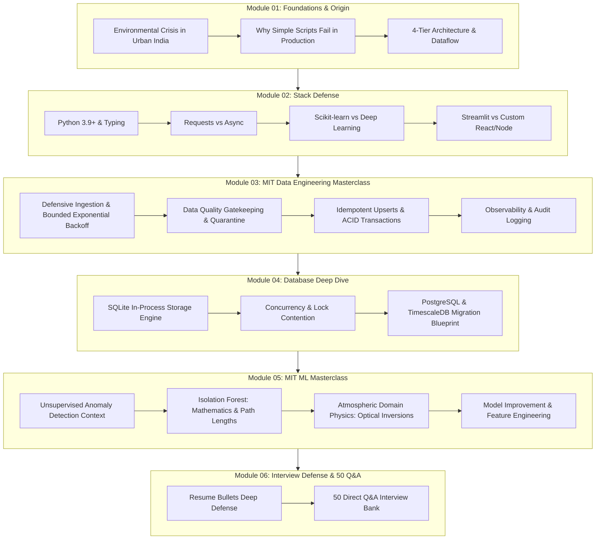

# AQI India Intelligence Platform — Master Learning Curriculum & Architecture Syllabus

> **Curriculum Lead**: MIT Senior Lecturer & Principal Staff Data/ML Engineer (15+ Years Industry & Research Experience)  
> **Target Audience**: New engineers, interview candidates, data engineers, and applied machine learning practitioners seeking deep, first-principles mastery of this production-grade pipeline.

---

## 1. Executive Summary & Curriculum Roadmap

Welcome to the definitive engineering curriculum for the **India AQI Intelligence Pipeline**. This codebase is not a generic tutorial script; it is a battle-tested, decoupled 4-tier data engineering, analytics, and unsupervised machine learning platform that ingests, sanitizes, audits, analyzes, and models multi-pollutant environmental telemetry across major Indian metropolitan cities.

This curriculum is structured into **6 master deep-dive modules**, designed to take you from zero knowledge to an elite, interview-defensible mastery of every single line of code, algorithmic decision, and architectural tradeoff.

---

## 2. Curriculum Module Index

| Module | Title | Core Focus & Deep Dive Topics |
| :--- | :--- | :--- |
| [**Module 01**](file:///c:/Users/harsh/OneDrive/Documents/Desktop/MYwebDEvprojects/AQI_India_ETL_Pipeline/learning/01_project_origin_story_and_foundations.md) | **Project Origin Story, Foundations & Architecture** | Urban pollution physics, sensor failures, 4-tier architecture, record lifecycle journey, lessons learned, and future streaming scope. |
| [**Module 02**](file:///c:/Users/harsh/OneDrive/Documents/Desktop/MYwebDEvprojects/AQI_India_ETL_Pipeline/learning/02_tech_stack_deep_dive_and_defense.md) | **Tech Stack Deep Dive & Counter-Factual Defense** | Python dataclasses/typing, Requests vs aiohttp, Pandas vectorized math, Scikit-learn vs Neural Nets, Streamlit, and Pytest offline mocking. |
| [**Module 03**](file:///c:/Users/harsh/OneDrive/Documents/Desktop/MYwebDEvprojects/AQI_India_ETL_Pipeline/learning/03_mit_professor_data_engineering_masterclass.md) | **MIT Data Engineering Masterclass** | Defensive ingestion, exponential backoff, HTTP 429 `Retry-After`, zero-imputation catastrophe, dead-letter quarantine, idempotency, and enterprise scale-up. |
| [**Module 04**](file:///c:/Users/harsh/OneDrive/Documents/Desktop/MYwebDEvprojects/AQI_India_ETL_Pipeline/learning/04_database_deep_dive_sqlite_vs_postgres.md) | **Database Engineering: SQLite vs PostgreSQL** | Serverless embedded SQLite vs PostgreSQL daemon, B-Tree indexing, write locks vs MVCC, connection pooling, and TimescaleDB time-series migration. |
| [**Module 05**](file:///c:/Users/harsh/OneDrive/Documents/Desktop/MYwebDEvprojects/AQI_India_ETL_Pipeline/learning/05_mit_professor_ml_masterclass_isolation_forest.md) | **MIT ML Masterclass: Isolation Forest & Atmospheric Physics** | Mathematical proof of $s(x,n) = 2^{-\frac{E(h(x))}{c(n)}}$, iTrees, multi-dimensional feature space, optical inversions ($PM_{2.5} > PM_{10}$), and feature engineering. |
| [**Module 06**](file:///c:/Users/harsh/OneDrive/Documents/Desktop/MYwebDEvprojects/AQI_India_ETL_Pipeline/learning/06_interview_defense_and_50_qna_bank.md) | **Interview Defense Guide & 50 Direct Q&A Bank** | Line-by-line defense of the 3 resume bullets, trap questions, architectural whiteboarding, and 50 rigorous questions & answers across 6 engineering categories. |

---

## 3. Recommended Reading Tracks

Depending on your upcoming objective, pick the track that maximizes your return on time:

### Track A: The Interview Candidate (48 Hours to Interview)
1. Read **Module 06 (Interview Defense & 50 Q&A)** first to memorize the exact verbal scripts for your 3 resume bullets.
2. Review **Module 03 (Data Engineering)** sections on idempotency and quarantine dead-letter routing.
3. Review **Module 05 (ML Masterclass)** for the intuitive explanation of Isolation Forest and the optical inversion check.
4. Review **Module 04 (Database)** to answer *"Why did you use SQLite instead of PostgreSQL?"*

### Track B: The Data Engineering Specialist
1. Start with **Module 01** to understand the record lifecycle.
2. Deep dive into **Module 03** to master the exponential backoff mathematics, HTTP status triage, and dead-letter quarantine.
3. Master **Module 04** on SQLite locking mechanics vs PostgreSQL MVCC and TimescaleDB hypertables.

### Track C: The Applied ML & Analytics Engineer
1. Read **Module 01** for domain context on air pollution metrics.
2. Master **Module 05** to understand the mathematical derivation of expected path lengths $c(n)$, unsupervised anomaly scores, and feature engineering with diurnal weather variables.
3. Review `src/aqi_pipeline/anomaly.py` and `src/aqi_pipeline/analytics.py` alongside Module 05.

