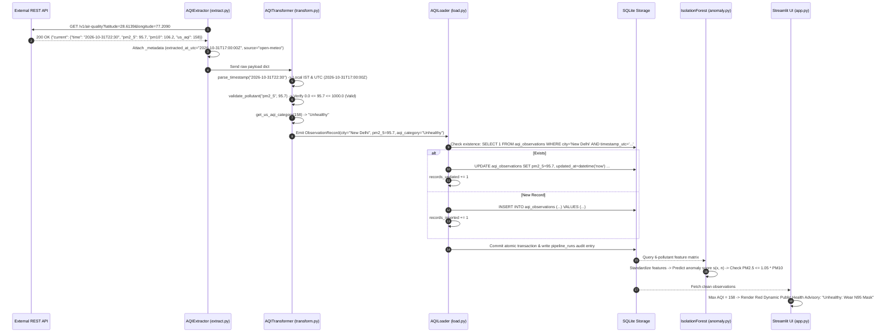

# Module 01 — Project Origin Story, Foundations & System Architecture

> **Author**: MIT Senior Lecturer & Principal Staff Data/ML Engineer  
> **Grounded in Codebase**: [`src/aqi_pipeline/`](file:///c:/Users/harsh/OneDrive/Documents/Desktop/MYwebDEvprojects/AQI_India_ETL_Pipeline/src/aqi_pipeline/), [`app.py`](file:///c:/Users/harsh/OneDrive/Documents/Desktop/MYwebDEvprojects/AQI_India_ETL_Pipeline/app.py)

---

## 1. Project Origin Story: The Real-World Problem

Every winter across Northern India, a severe public health crisis unfolds. Cities like New Delhi, Lucknow, and Ahmedabad become blanketed in hazardous smog. Fine particulate matter smaller than 2.5 micrometers ($\text{PM}_{2.5}$) regularly exceeds $400\,\mu\text{g/m}^3$—more than **25 times** the safe limits recommended by the World Health Organization (WHO). These microscopic particles bypass the nasal passages, penetrate deep into the lungs, enter the bloodstream, and trigger acute respiratory distress, cardiovascular failure, and long-term pulmonary diseases.

To combat this, public health authorities, smart city dashboards, and citizen advisories rely heavily on continuous air quality monitoring data streams. However, **raw environmental telemetry from physical monitoring stations and weather APIs is notoriously dirty, unstable, and fragile**:

1. **Hardware Malfunctions & Optical Drift**: Optical dust sensors use laser scattering to count particles. High humidity, dust storms, or internal optical condensation cause baseline drift, generating physically impossible readings (e.g., negative particulate concentrations or $\text{PM}_{2.5} > \text{PM}_{10}$).
2. **Intermittent Network Disconnects & Dropped Telemetry**: IoT sensors and transmission stations in Indian metros frequently lose internet connectivity or drop telemetry packets due to power fluctuations.
3. **API Rate Limiting & Throttling**: Public and commercial environmental API endpoints strictly throttle high-frequency traffic with HTTP 429 status codes. Naive automated ingestion scripts crash or get permanently blocked by rate limiters.
4. **Silent Corruption & Schema Drift**: Upstream providers occasionally introduce `null` values, change timestamp formats (mixing naive local Indian Standard Time with ISO UTC), or return malformed JSON payloads.

### Why Typical Beginner Scripts Fail in Production
A novice programmer writes a 30-line Python script with `requests.get()` and `df.to_sql()`. In production, this naive script crashes within hours:
- It crashes on the first HTTP timeout or 500 server hiccup because it lacks retry logic.
- It exhausts API quotas by hammering endpoints during an outage because it lacks exponential backoff.
- It silently writes duplicates into the database on scheduled re-runs because it lacks idempotency.
- Most dangerously, it replaces missing sensor data with zeros (`df.fillna(0)`), causing an analytical report to claim that downtown New Delhi had "pristine mountain air" (AQI = 0) simply because a sensor went offline.

**This project was engineered from the ground up to solve these exact production challenges.**

---

## 2. Decoupled 4-Tier Architecture

To achieve enterprise reliability, the platform separates concerns into four distinct, isolated tiers:

```mermaid
flowchart TD
    subgraph T1["Tier 1: Extraction & Ingestion Engine (extract.py)"]
        API["Open-Meteo REST API<br/>(/v1/air-quality)"] -->|HTTP GET with Session| EXT["AQIExtractor"]
        EXT -->|Transient 5xx / 429| RETRY["Bounded Exponential Backoff<br/>+ Retry-After Inspection"]
        RETRY -.->|Retry| EXT
        EXT -->|Permanent 4xx / Corrupt JSON| FAIL["Fail-Fast Terminal ExtractionError"]
        EXT -->|Offline Flag| FIX["Zero-Dependency Local Fixtures<br/>(batch_cities_response.json)"]
        EXT -->|Enrich Payload| RAW["Raw Ingestion Payloads<br/>Tagged with _metadata (UTC, Source)"]
    end

    subgraph T2["Tier 2: Transformation & Data Quality Gate (transform.py)"]
        RAW --> TF["AQITransformer"]
        TF --> VAL_TS["Parse & Canonicalize Timestamps<br/>(IST UTC+05:30 -> ISO UTC)"]
        TF --> VAL_BOUNDS["Physical Boundary Checks<br/>(0.0 <= PM2.5 <= 1000.0, etc.)"]
        TF --> VAL_NULLS["Strict Null Preservation<br/>(No Silent Zero-Imputation)"]
        TF -->|Pass Boundary| OBS["ObservationRecord Dataclasses"]
        TF -->|Fail Boundary / Corrupt| QUAR["QuarantineRecord Dataclasses<br/>(Preserves Bad JSON + Explicit Reason)"]
    end

    subgraph T3["Tier 3: Relational Persistence & Idempotency (load.py)"]
        OBS --> LD["AQILoader"]
        QUAR --> LD
        LD -->|Atomic Transaction BEGIN| TX["SQLite Write Engine"]
        TX -->|Natural Key (city, timestamp_utc)| UPSERT["ON CONFLICT DO UPDATE<br/>(True Idempotency)"]
        UPSERT --> TBL_OBS[("aqi_observations<br/>(Clean Relational Data)")]
        TX -->|Append Invalid Data| TBL_QUAR[("aqi_quarantine<br/>(Dead-Letter Audit Table)")]
        TX -->|Commit / Rollback| AUDIT["Record Pipeline Run Audit<br/>(pipeline_runs Table)"]
    end

    subgraph T4["Tier 4: Intelligence, Analytics & UI (analytics.py, anomaly.py, app.py)"]
        TBL_OBS --> SQL_ENG["SQL Analytics Engine<br/>- PM2.5/PM10 Mass Ratios<br/>- Regional Zonal Aggregations<br/>- Diurnal Smog Variations"]
        TBL_OBS --> ML_ENG["Unsupervised ML Anomaly Detection<br/>- Scikit-learn Isolation Forest<br/>- 6-Pollutant Feature Matrix<br/>- Optical Inversion Checks"]
        SQL_ENG --> UI["Streamlit Intelligence Dashboard (app.py)<br/>- Interactive City Maps & Altair Trends<br/>- Dynamic Public Health Advisory Alerts<br/>- One-Click Clean Dataset CSV Export"]
        ML_ENG --> UI
        TBL_QUAR --> UI
    end
```

---

## 3. The Lifecycle of a Single Record Through the Pipeline

To truly understand the system, trace one real-world observation from New Delhi as it journeys through the entire codebase:



---

## 4. Key Personal Takeaways & Engineering Wisdom ("What I Learnt")

Building this production-grade pipeline taught critical lessons rarely taught in academic courses:

1. **"Data Engineering is 80% Defensive Gatekeeping"**: 
   Anyone can write an SQL `INSERT` statement. The real engineering challenge is building boundary checks, preventing silent zero-imputations, handling HTTP 429 rate limits, and routing bad data to dead-letter quarantine without crashing the pipeline.
2. **"Idempotency is Non-Negotiable"**:
   Batch pipelines will be re-run manually by on-call engineers, retried by schedulers, and triggered backfills. If your database write logic cannot guarantee that running 10 times produces the exact same state as running once, you do not have a production data pipeline.
3. **"Domain Physics Must Override Machine Learning"**:
   A machine learning model (like an Isolation Forest) is purely a statistical pattern recognizer. It does not know atmospheric physics. If a model predicts that an observation with $\text{PM}_{2.5} = 250$ and $\text{PM}_{10} = 100$ is "normal" because it falls within dense multivariate clusters, the data engineer must override it with a hard domain boundary rule ($\text{PM}_{2.5} > 1.05 \times \text{PM}_{10}$ indicates optical sensor malfunction).

---

## 5. Real-World Use Cases & Future Scope

### Current Practical Applications
- **Smart City Public Health Alerting**: Automated feeds for municipal websites to trigger smog warnings and traffic restrictions based on EPA AQI breakpoints.
- **Epidemiological Research**: Historical database for public health researchers studying pulmonary illness admissions correlated with multi-pollutant spikes.
- **Industrial Compliance Auditing**: Cross-referencing ambient factory zone sensors against regional baselines to identify illegal nighttime particulate discharge.

### Enterprise Future Scope & Scale-Up Blueprint
If scaled from an embedded metropolitan prototype to a nationwide enterprise ingestion platform processing 50,000 IoT sensors:
- **Streaming Ingestion (Apache Kafka & Apache Flink)**: Transition from hourly batch HTTP extraction to sub-second sensor telemetry streams via MQTT/Kafka topics, computing sliding-window aggregations in Flink.
- **Geospatial Indexing (PostGIS & Uber H3)**: Index sensors using hexagonal H3 spatial cells to perform spatial air pollution interpolation (kriging) across Indian districts.
- **Cloud Data Lake & Delta Lake**: Land raw telemetry in AWS S3 / GCP Cloud Storage as a Medallion architecture (Bronze = raw JSON, Silver = sanitized observations, Gold = analytical aggregations).

