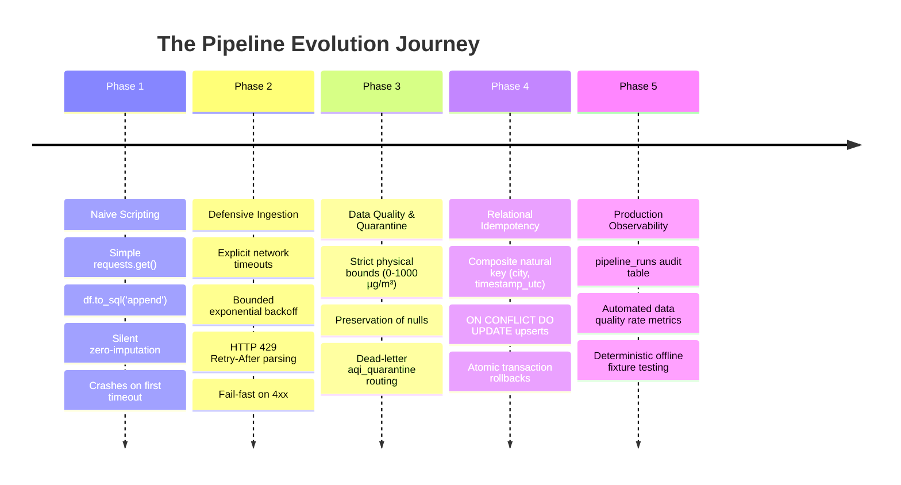
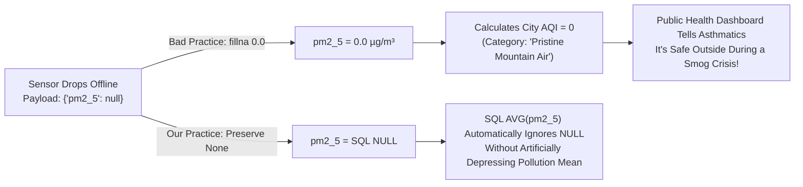
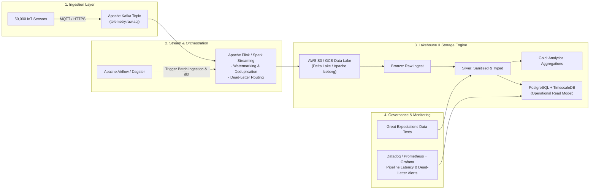

# Module 03 — MIT Data Engineering Masterclass: Building Resilient Production Pipelines

> **Instructor**: MIT Senior Lecturer & Principal Staff Data Engineer (15+ Years Industry Experience)  
> **Course Core**: First-Principles Data Engineering, Defensive Ingestion, Quarantine Patterns, and Idempotency  
> **Grounded in Codebase**: [`extract.py`](file:///c:/Users/harsh/OneDrive/Documents/Desktop/MYwebDEvprojects/AQI_India_ETL_Pipeline/src/aqi_pipeline/extract.py), [`transform.py`](file:///c:/Users/harsh/OneDrive/Documents/Desktop/MYwebDEvprojects/AQI_India_ETL_Pipeline/src/aqi_pipeline/transform.py), [`load.py`](file:///c:/Users/harsh/OneDrive/Documents/Desktop/MYwebDEvprojects/AQI_India_ETL_Pipeline/src/aqi_pipeline/load.py)

---

## 1. The Philosophy of Production Data Engineering

Welcome, engineers. In my 15 years designing distributed data infrastructure at scale, I have witnessed thousands of pipelines fail. They rarely fail because the database was too slow or the SQL query was poorly formatted. **They fail because the data engineer assumed the external world would behave politely.**

In academic coursework, data arrives in clean CSV files or well-behaved SQL tables. In industry:
- APIs throttle your requests unpredictably with HTTP 429 errors.
- Sensor hardware suffers optical drift and reports negative particulate matter.
- Schedulers re-trigger batch jobs twice, resulting in doubled counts and corrupted metrics.
- Missing values get converted into zeros, turning an environmental disaster into a fake report of clean air.

A junior developer writes code for the **happy path**. A principal staff engineer spends 90% of their architectural effort engineering the **failure modes**.

In this masterclass, we dissect how we built the **India AQI ETL Pipeline** step-by-step from scratch, the mathematical principles behind each pattern, and how to defend every design choice in an elite technical interview.

---

## 2. Evolution of the Pipeline: How We Thought of It vs How We Engineered It



---

## 3. Tier 1: Resilient Extraction & Ingestion ([`extract.py`](file:///c:/Users/harsh/OneDrive/Documents/Desktop/MYwebDEvprojects/AQI_India_ETL_Pipeline/src/aqi_pipeline/extract.py))

### 3.1 Bounded Exponential Backoff Algorithm
When a remote server hiccups (HTTP 500/502/503/504) or a network connection drops, immediately retrying in a tight loop is an anti-pattern known as a **retry storm** or **thundering herd**. It overwhelms an already struggling server and wastes client resources.

Instead, we implement **bounded exponential backoff**:

$$\Delta t_{\text{sleep}} = \beta \cdot 2^{(\text{attempt} - 1)}$$

Where:
- $\beta$ is the base `backoff_factor` (configured as $1.5\text{ seconds}$).
- $\text{attempt} \in \{1, 2, 3\}$.

| Attempt | Sleep Calculation | Delay Before Next Request |
| :---: | :---: | :---: |
| 1 | $1.5 \cdot 2^0$ | **1.5 seconds** |
| 2 | $1.5 \cdot 2^1$ | **3.0 seconds** |
| 3 | $1.5 \cdot 2^2$ | **6.0 seconds** |
| Post-3 | Max retries exhausted | Raise terminal `ExtractionError` |

### 3.2 Rate-Limit Triage: HTTP 429 & The `Retry-After` Header
When an API responds with `HTTP 429 Too Many Requests`, naive algorithms continue with standard backoff. However, RFC 6585 and RFC 7231 specify that servers MAY include a `Retry-After` header indicating the exact number of seconds to wait.

In `extract.py`:
```python
if response.status_code == 429:
    hdr = response.headers.get("Retry-After")
    sleep_time = float(hdr) if hdr and hdr.isdigit() else self._calc_backoff(attempt)
    self.logger.warning(f"Rate limited (429) for {city_name}. Backing off {sleep_time:.2f}s...")
    time.sleep(sleep_time)
    continue
```
*Why this matters in interviews*: It proves you understand HTTP protocols and rate-limiting contracts rather than treating the web like a black box.

### 3.3 Error Classification: Transient vs Permanent
Not all HTTP errors should be retried!
- **Transient Errors (Retry with backoff)**: HTTP 500, 502, 503, 504, connection resets, network timeouts. The server is temporarily overloaded or an intermediary router dropped packets.
- **Permanent Errors (Fail Fast without retry)**: HTTP 400 (Bad Request), 401 (Unauthorized), 403 (Forbidden), 404 (Not Found). These indicate client-side coding bugs, invalid coordinates, or expired API keys. Retrying them exhausts your retry budget pointlessly.
```python
if 400 <= response.status_code < 500:
    err_msg = f"Permanent client error HTTP {response.status_code} for {city_name}"
    self.logger.error(err_msg)
    raise ExtractionError(err_msg)
```

---

## 4. Tier 2: Transformation & Data Quality Gatekeeping ([`transform.py`](file:///c:/Users/harsh/OneDrive/Documents/Desktop/MYwebDEvprojects/AQI_India_ETL_Pipeline/src/aqi_pipeline/transform.py))

### 4.1 The Cardinal Sin: Silent Zero-Imputation
In software engineering, substituting `0.0` for `None` or `null` is common practice (`val = raw.get('reading') or 0.0`).  
**In environmental and sensor data engineering, this is a catastrophic bug.**



### 4.2 The Dead-Letter Quarantine Pattern
What should happen when an upstream API returns corrupted data (e.g. `pm2_5: -45.0` or an unparseable timestamp)?
- **Bad Approach 1**: Crash the entire pipeline (`raise ValueError`). This halts ingestion for all 8 cities because of 1 bad sensor.
- **Bad Approach 2**: Drop the record silently (`pass`). This destroys data auditability. You can never troubleshoot why a city's observations are missing.
- **The Staff Engineer Pattern: Dead-Letter Quarantine**:
  Route the invalid payload to a dedicated `QuarantineRecord` dataclass, preserving the city, local timestamp, raw JSON snippet, and the **explicit rejection reason**. The good records continue to the database; the bad records are saved to an `aqi_quarantine` table for audit reporting!

```python
for field_name in pollutant_fields:
    is_valid, val, err_reason = self.validate_pollutant(field_name, current.get(field_name))
    if not is_valid:
        return None, self._quarantine(city, time_local, f"Data quality violation: {err_reason}", current)
    cleaned_values[field_name] = val
```

### 4.3 Timestamp Normalization (IST to UTC)
Sensors in India report in Indian Standard Time (IST, UTC+05:30). If stored without canonicalization:
1. Cross-region comparisons with UTC satellite models become misaligned.
2. Daylight saving or local ambiguities distort chronological ordering.
We parse naive timestamps, attach `IST_TZ` (`timezone(timedelta(hours=5, minutes=30))`), and canonicalize to ISO-8601 UTC strings (`YYYY-MM-DDTHH:MM:SS+00:00`).

---

## 5. Tier 3: Persistence, Idempotency & ACID Transactions ([`load.py`](file:///c:/Users/harsh/OneDrive/Documents/Desktop/MYwebDEvprojects/AQI_India_ETL_Pipeline/src/aqi_pipeline/load.py))

### 5.1 What is Idempotency and Why is it Critical?
> **Mathematical Definition**: An operation $f$ is idempotent if applying it multiple times produces the identical result as applying it once:  
> $$f(f(x)) = f(x)$$

In data engineering, schedulers (cron, Airflow) often fail mid-run or re-trigger jobs. If your pipeline is not idempotent, running it twice will insert duplicate rows. If New Delhi had 24 observations, running twice creates 48 observations, doubling cumulative particulate totals and corrupting historical averages.

### 5.2 How We Implemented Idempotency in SQLite
We defined a **composite natural unique constraint** on `(city, timestamp_utc)`:
```sql
CONSTRAINT uq_city_timestamp UNIQUE (city, timestamp_utc)
```
Why this natural key?
- A surrogate key (`id INTEGER PRIMARY KEY AUTOINCREMENT`) cannot detect that two incoming JSON records represent the same physical measurement.
- `city` identifies the spatial coordinate.
- `timestamp_utc` identifies the exact physical instant in time.

Then, we leverage SQLite's `INSERT ... ON CONFLICT DO UPDATE` upsert syntax:
```sql
INSERT INTO aqi_observations (
    city, state, zone, latitude, longitude,
    timestamp_local, timestamp_utc,
    pm2_5, pm10, provider_aqi, aqi_category, extracted_at_utc, created_at, updated_at
) VALUES (...)
ON CONFLICT(city, timestamp_utc) DO UPDATE SET
    pm2_5 = excluded.pm2_5,
    pm10 = excluded.pm10,
    provider_aqi = excluded.provider_aqi,
    aqi_category = excluded.aqi_category,
    extracted_at_utc = excluded.extracted_at_utc,
    updated_at = datetime('now');
```
*Result*: Running the pipeline twice on the same data inserts $N$ rows on run 1, and updates $N$ rows on run 2. Total database rows remain constant!

### 5.3 Transactional Atomicity (All-or-Nothing)
If an ingestion batch of 8 cities experiences an OS crash or disk I/O failure on city 7:
```python
with self.get_connection() as conn:
    try:
        conn.execute("BEGIN TRANSACTION;")
        # ... execute upserts ...
        conn.commit()
    except Exception as exc:
        conn.rollback() # Restores database to pristine pre-run state!
        raise
```
This guarantees **ACID Atomicity**: the analytical database is never left in a corrupted, half-loaded state.

---

## 6. Tier 4: Pipeline Observability & Audit Trails

Production systems must answer: *"Did the pipeline run at 02:00 AM? How many records were accepted? Why was the clean data rate only 75%?"*

We created the `pipeline_runs` audit table:
```sql
CREATE TABLE IF NOT EXISTS pipeline_runs (
    id INTEGER PRIMARY KEY AUTOINCREMENT,
    run_id TEXT UNIQUE NOT NULL,
    execution_mode TEXT NOT NULL,
    status TEXT NOT NULL,          -- 'STARTED', 'SUCCESS', 'FAILED'
    records_extracted INTEGER DEFAULT 0,
    records_accepted INTEGER DEFAULT 0,
    records_quarantined INTEGER DEFAULT 0,
    records_inserted INTEGER DEFAULT 0,
    records_updated INTEGER DEFAULT 0,
    started_at TEXT NOT NULL,
    finished_at TEXT,
    elapsed_seconds REAL,
    error_message TEXT
);
```

In `analytics.py`, `get_data_quality_report()` queries this audit log and calculates the live **Clean Data Rate**:
$$\text{Clean Data Rate} = \frac{\text{Accepted Observations}}{\text{Accepted Observations} + \text{Quarantined Records}} \times 100\%$$

---

## 7. Blueprint: How to Scale This Pipeline to Enterprise Production

If asked in an interview how you would take this architecture to a Fortune 500 company or national government agency, provide this exact blueprint:



