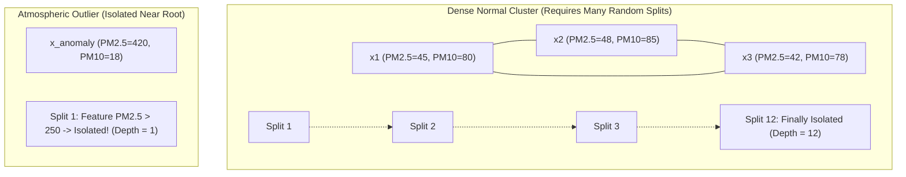

# Module 05 — MIT ML Masterclass: Isolation Forest, Mathematics & Atmospheric Physics

> **Instructor**: MIT Senior Lecturer & Principal Applied ML Engineer (15+ Years Experience)  
> **Course Core**: Unsupervised Anomaly Detection, Path-Length Proofs, Domain Rules, and Feature Engineering  
> **Grounded in Codebase**: [`anomaly.py`](file:///c:/Users/harsh/OneDrive/Documents/Desktop/MYwebDEvprojects/AQI_India_ETL_Pipeline/src/aqi_pipeline/anomaly.py), [`analytics.py`](file:///c:/Users/harsh/OneDrive/Documents/Desktop/MYwebDEvprojects/AQI_India_ETL_Pipeline/src/aqi_pipeline/analytics.py)

---

## 1. The Machine Learning Problem Framing: Why Unsupervised?

In textbook machine learning, students train supervised classifiers (Random Forests, XGBoost, Logistic Regression) using millions of labeled training examples: $y \in \{0, 1\}$.

In real-world environmental sensor streams, **ground-truth labels do not exist**:
- When a laser dust sensor in New Delhi suffers an optical chamber condensation glitch at 03:00 AM, no technician is standing beside it to label the database record as `anomaly = 1`.
- When an unexpected industrial chemical explosion releases a massive burst of $\text{SO}_2$ and $\text{NO}_2$, it has never been seen before in historical training sets.

Because true anomalies are rare, unlabelled, and diverse, **unsupervised density and isolation modeling is the only viable production approach.**

---

## 2. Why Isolation Forest Over Competing Algorithms?

Before writing code, we evaluated the primary unsupervised anomaly detection paradigms:

| Algorithm Paradigm | Candidate Model | Time Complexity | Core Failure Mode in Environmental Streams |
| :--- | :--- | :--- | :--- |
| **Statistical Distance** | Multi-dimensional Mahalanobis Distance / Z-Score | $O(n \cdot d + d^3)$ | Assumes normal Gaussian distributions. Atmospheric pollutants follow heavy-tailed log-normal or Pareto distributions. |
| **Density-Based** | **DBSCAN** | $O(n^2)$ | Fails when clusters have variable densities (e.g. clean coastal Chennai vs smog-choked New Delhi). Distance metrics degrade in high dimensions (**curse of dimensionality**). |
| **Local Density** | **Local Outlier Factor (LOF)** | $O(n^2)$ | Prohibitively expensive computational complexity for real-time inference; cannot easily score new unseen observations without recomputing neighbor graphs. |
| **Kernel / Boundary** | **One-Class SVM** | $O(n^2)$ to $O(n^3)$ | Extremely sensitive to hyperparameter choices ($\gamma$ and $\nu$); quadratic memory consumption on large tabular datasets. |
| **Random Partitioning**| **Isolation Forest (Our Choice)** | **$O(t \cdot \psi \log \psi)$** | **Linear time complexity**, sub-sample efficiency, robust to non-linear correlations, zero distance-metric calculations. |

---

## 3. How Isolation Forest Really Works: Mathematical Derivation

Isolation Forest (Liu, Ting, & Zhou, 2008) operates on a profound counter-intuitive insight:  
> **"Instead of profiling what is normal, it is far faster and mathematically simpler to explicitly isolate what is anomalous."**

### 3.1 The Intuition
Imagine a room with 1,000 normal people clustered closely together, and 1 giant standing far out in the corner. If you draw random straight lines across the room, how many cuts does it take to separate the giant from everyone else?  
**Just 1 or 2 cuts.**  
How many cuts does it take to isolate one specific person inside the dense crowd?  
**Dozens of cuts.**



### 3.2 The Isolation Tree (iTree) Algorithm
1. Given a dataset of $n$ instances, sample a subset $X' \subset X$ of size $\psi$ (typically $\psi = 256$).
2. Recursively partition the subset:
   - Randomly pick a feature $q$ from the feature matrix (e.g. `pm2_5`).
   - Randomly select a split threshold $p$ uniformly between $\min(q)$ and $\max(q)$.
   - Partition data into two child nodes: $X_{\text{left}} = \{x \mid x_q < p\}$ and $X_{\text{right}} = \{x \mid x_q \ge p\}$.
3. Repeat recursively until either:
   - The tree reaches its maximum depth limit: $h_{\max} = \lceil \log_2(\psi) \rceil$.
   - The node contains $|X| \le 1$.
   - All data in the node have identical values.

### 3.3 Path Length $h(x)$ and Expected Average Path $c(n)$
Let $h(x)$ be the path length (number of edges traversed from root to leaf) to isolate instance $x$.

Because iTrees have an equivalent structure to Binary Search Trees (BST), the average path length of an unsuccessful search in a BST constructed over $n$ items is a well-known mathematical result:

$$c(n) = 2 \ln(n - 1) + 2\gamma - \frac{2(n - 1)}{n}$$

Where:
- $\gamma \approx 0.5772156649$ is the **Euler-Mascheroni constant**.
- $c(n)$ serves as the theoretical normalization factor: the average depth expected for a normal instance in a dataset of size $n$.

### 3.4 The Anomaly Score Formula $s(x, n)$
The anomaly score of an instance $x$ over an ensemble of $t$ isolation trees is defined as:

$$s(x, n) = 2^{-\frac{\mathbb{E}[h(x)]}{c(n)}}$$

Where $\mathbb{E}[h(x)]$ is the average path length of $x$ across all trees.

Now, analyze the mathematical behavior of this exponent:
1. **When $\mathbb{E}[h(x)] \to 0$ (Instance isolated in very few splits near root)**:
   $$\frac{\mathbb{E}[h(x)]}{c(n)} \to 0 \implies s(x, n) \to 2^0 = \mathbf{1.0}$$
   **Conclusion**: $s(x, n) \to 1.0 \implies \mathbf{Definite\ Anomaly}$.
2. **When $\mathbb{E}[h(x)] \to c(n)$ (Instance isolated at average tree depth)**:
   $$\frac{\mathbb{E}[h(x)]}{c(n)} \to 1 \implies s(x, n) \to 2^{-1} = \mathbf{0.5}$$
   **Conclusion**: $s(x, n) \approx 0.5 \implies \mathbf{Completely\ Normal\ Data}$.
3. **When $\mathbb{E}[h(x)] \to n - 1$ (Instance deeply buried inside dense cluster)**:
   $$\frac{\mathbb{E}[h(x)]}{c(n)} \to \infty \implies s(x, n) \to 2^{-\infty} = \mathbf{0.0}$$
   **Conclusion**: $s(x, n) \to 0.0 \implies \mathbf{Extreme\ Central\ Inlier}$.

---

## 4. Atmospheric Physics vs Pure Machine Learning: The Inversion Rule

One of the greatest dangers in applied data science is assuming the statistical model is omniscient.

In atmospheric science, particulate matter is defined by aerodynamic diameter:
- $\text{PM}_{10}$ contains all particles with diameter $\le 10\,\mu\text{m}$.
- $\text{PM}_{2.5}$ contains all particles with diameter $\le 2.5\,\mu\text{m}$.

$$\mathbf{PM}_{2.5} \subset \mathbf{PM}_{10} \implies \mathbf{PM}_{2.5} \le \mathbf{PM}_{10}\ (\text{Always\ in\ Nature})$$

In optical sensors, fine particles ($\text{PM}_{2.5}$) and coarse particles ($\text{PM}_{10}$) are measured via distinct optical laser channels. When moisture or insect debris enters the fine chamber, the sensor can report:
$$\text{PM}_{2.5} = 150\,\mu\text{g/m}^3, \quad \text{PM}_{10} = 80\,\mu\text{g/m}^3$$

Because both numbers are within plausible individual ranges ($0 - 1000$), an unsupervised Isolation Forest might evaluate this vector as "normal" if other cities in the cluster also have high readings.

In [`src/aqi_pipeline/anomaly.py`](file:///c:/Users/harsh/OneDrive/Documents/Desktop/MYwebDEvprojects/AQI_India_ETL_Pipeline/src/aqi_pipeline/anomaly.py), we engineer a **hybrid domain rule** that overrides the model:
```python
# Optical Sensor Inversion Check (Physical Impossible State)
pm_ratio_inversion = (df["pm2_5"] > (1.05 * df["pm10"])) & (df["pm10"] > 0)
df["is_inversion_anomaly"] = pm_ratio_inversion
df["is_anomaly"] = df["is_anomaly"] | df["is_inversion_anomaly"]
```
*Why 1.05?* We include a 5% margin to account for minor optical measurement jitter.

---

## 5. Comprehensive Guide: How to Radically Improve the Model's Classification

If an interviewer asks: *"What would you do to take your anomaly detection model to the next level?"*, outline these 4 advanced dimensions:

### 5.1 Advanced Feature Engineering
Currently, the model trains on raw pollutant concentrations: `[pm2_5, pm10, co, no2, so2, o3]`. To capture subtle anomalies, engineer temporal and contextual features:
1. **Diurnal Cyclical Encoding**: Pollution in Indian cities exhibits sharp daily cycles (spiking during morning/evening rush hours, dipping at midday). Feed time as cyclic sine/cosine waves:
   $$\text{hour\_sin} = \sin\left(\frac{2\pi \cdot \text{hour}}{24}\right), \quad \text{hour\_cos} = \cos\left(\frac{2\pi \cdot \text{hour}}{24}\right)$$
2. **Rolling 24-Hour Z-Scores**: Calculate how much the current reading deviates from that city's rolling 24-hour mean:
   $$z_{\text{city}}(t) = \frac{x(t) - \mu_{24\text{h}}}{\sigma_{24\text{h}}}$$
3. **Explicit Cross-Pollutant Mass Ratios**:
   $$r_{\text{PM}} = \frac{\text{PM}_{2.5}}{\text{PM}_{10}}, \quad r_{\text{gas}} = \frac{\text{NO}_2}{\text{CO}}$$

### 5.2 Incorporating Weather Covariates
Air quality is inextricably tied to meteorology. In winter, atmospheric **temperature inversions** trap pollutants near ground level. Adding meteorological cross-features separates genuine sensor failures from atmospheric smog traps:
- **Wind Speed & Direction**: Stagnant air ($\text{wind} < 1\,\text{m/s}$) correlates with natural smog accumulation; high wind with high PM indicates a dust storm or localized emitter.
- **Relative Humidity**: High humidity causes optical hygroscopic growth of sulfate particles, triggering false optical spikes.
- **Planetary Boundary Layer (PBL) Height**: Low boundary layers compress pollutants into a narrow air column.

### 5.3 Contamination Parameter Calibration via Synthetic Injection
Isolation Forest requires setting `contamination` (the expected proportion of outliers, default $0.10$). Setting this arbitrarily is unscientific.

To optimize contamination scientifically without ground truth:
1. Generate **synthetic atmospheric anomalies** (e.g. injecting sudden $5\sigma$ spikes, flatline dropouts, and inverted ratios into 5% of a clean test partition).
2. Measure **Precision-Recall AUC (PR-AUC)** across a grid of contamination values $\alpha \in [0.01, 0.15]$.
3. Select $\alpha^*$ that maximizes the F1-score on detecting the synthetic anomalies while minimizing false positive flags on normal baseline variations.

### 5.4 Semi-Supervised Active Learning Loop
Deploy a feedback loop in the Streamlit UI:
- When an observation is flagged as an anomaly, domain experts (environmental analysts) click a button: `[Confirm Malfunction]` or `[Valid Smog Episode]`.
- Store user feedback in an `anomaly_feedback` table.
- Use these labels to train a semi-supervised **XGBoost / LightGBM** classifier that learns from expert confirmations.

