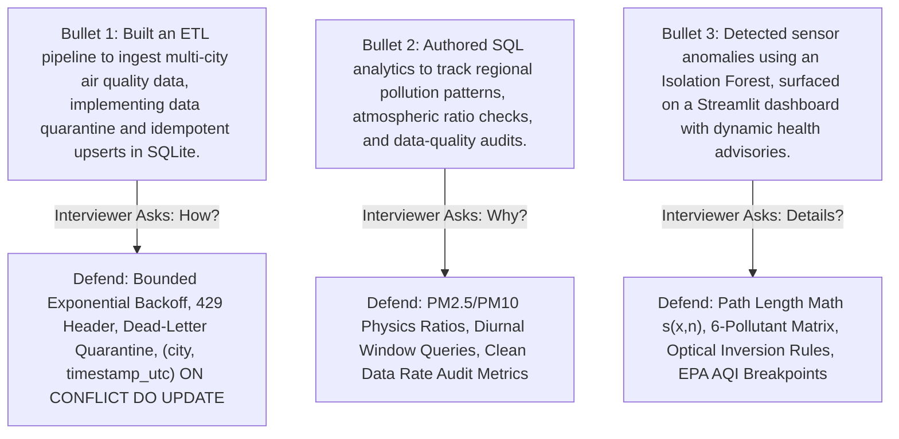

# Module 06 — Interview Defense Guide & 50 Direct Q&A Question Bank

> **Instructor**: MIT Senior Lecturer & Principal Staff Data/ML Engineer (15+ Years Industry Experience)  
> **Course Core**: Complete Defense of Resume Bullets, Trap Identification, and 50 Exhaustive Technical Q&As  
> **Grounded in Entire Repository**: [`src/aqi_pipeline/`](file:///c:/Users/harsh/OneDrive/Documents/Desktop/MYwebDEvprojects/AQI_India_ETL_Pipeline/src/aqi_pipeline/), [`tests/`](file:///c:/Users/harsh/OneDrive/Documents/Desktop/MYwebDEvprojects/AQI_India_ETL_Pipeline/tests/), [`app.py`](file:///c:/Users/harsh/OneDrive/Documents/Desktop/MYwebDEvprojects/AQI_India_ETL_Pipeline/app.py)

---

## Part 1: Deep Defense of Your 3 Resume Bullets

Here are your exact 3 resume bullets. When an interviewer points to your resume, deliver these concise, authoritative explanations:

---

### Resume Bullet 1:
> **"Built an ETL pipeline to ingest multi-city air quality data, implementing data quarantine and idempotent upserts in SQLite."**

- **The Bait**: The interviewer will immediately jump on `"data quarantine"` and `"idempotent upserts"`.
- **Your Verbal Defense (30 Seconds)**:
  > *"I architected a decoupled Python ETL pipeline ingesting multi-pollutant measurements across 8 major Indian metropolitan cities. 
  > 
  > To ensure production reliability, extraction implements bounded exponential backoff retries with HTTP 429 `Retry-After` header inspection. 
  > 
  > The transformation stage validates physical boundaries and parses naive Indian Standard Time into canonical UTC. Crucially, it preserves missing values as `None` rather than silently zero-imputing them, and routes corrupted sensor readings into a dead-letter quarantine table with explicit rejection reasons without halting the batch run. 
  > 
  > Downstream, the loader executes atomic transactions and achieves true database idempotency using SQLite's `INSERT ... ON CONFLICT DO UPDATE` upsert syntax on a natural composite unique constraint of `(city, timestamp_utc)`."*

---

### Resume Bullet 2:
> **"Authored SQL analytics to track regional pollution patterns, atmospheric ratio checks, and data-quality audits."**

- **The Bait**: The interviewer will ask: *"What kind of atmospheric ratio checks did you write in SQL?"* and *"How did you audit data quality?"*
- **Your Verbal Defense (30 Seconds)**:
  > *"I developed an analytical SQL module that calculates diurnal variations and regional zonal metrics across North, South, East, and West Indian geography. 
  > 
  > To bridge data engineering with atmospheric physics, I wrote conditional ratio queries computing $\text{PM}_{2.5} / \text{PM}_{10}$ mass concentrations. In nature, $\text{PM}_{2.5}$ particles are physically contained within $\text{PM}_{10}$, so this ratio typically ranges between 0.3 and 0.8. When SQL flags a ratio $> 1.0$, it identifies optical sensor baseline drift or hardware calibration glitches. 
  > 
  > Finally, I implemented automated audit queries comparing accepted observations against quarantined records to compute a live Clean Data Rate percentage across pipeline executions."*

---

### Resume Bullet 3:
> **"Detected sensor anomalies using an Isolation Forest, surfaced on a Streamlit dashboard with dynamic health advisories."**

- **The Bait**: The interviewer will ask: *"Why Isolation Forest instead of a standard classifier or Z-score?"* and *"What does the dashboard show?"*
- **Your Verbal Defense (30 Seconds)**:
  > *"Because real sensor telemetry lacks ground-truth anomaly labels, I used an unsupervised Scikit-learn `IsolationForest` across a standardized 6-pollutant feature matrix ($\text{PM}_{2.5}, \text{PM}_{10}, \text{CO}, \text{NO}_2, \text{SO}_2, \text{O}_3$). 
  > 
  > The algorithm isolates multivariate outliers by recursively partitioning feature space, identifying anomalies near tree roots with significantly shorter average path lengths. I paired this with a domain boundary rule flagging physically impossible optical inversions where $\text{PM}_{2.5} > 1.05 \times \text{PM}_{10}$. 
  > 
  > Downstream, I built an interactive dark-mode Streamlit dashboard featuring geographic city maps, Altair time-series trends, an anomaly scatter plot, one-click CSV dataset downloads, and dynamic color-coded health alert banners based on US EPA AQI breakpoints."*

---

## Part 2: The 50 Direct Q&A Interview Bank

### Section 1: System Architecture & High-Level Engineering (Q1 - Q10)

#### Q1: Why did you design this as an ETL pipeline instead of an ELT pipeline?
- **Answer**: I chose ETL because we are ingesting from an external public REST API where raw sensor payloads can have schema anomalies and negative readings. Validating, cleaning, and quarantining dirty records in Python before loading prevents corrupting our relational tables. In ELT, raw unvalidated JSON blobs are landed in a cloud warehouse (Snowflake/BigQuery) and transformed via dbt, which makes sense at massive scale with cheap cloud storage, but degrades query performance on an embedded SQLite database.

#### Q2: What are the 4 tiers of your architecture, and why are they decoupled?
- **Answer**: The 4 tiers are: 
  1) **Extraction** (`extract.py`): Network calls, retries, and rate limits.
  2) **Transformation** (`transform.py`): Data cleansing, boundary checks, and dead-letter routing.
  3) **Loading** (`load.py`): Schema management, ACID transactions, and idempotent upserts.
  4) **Intelligence** (`analytics.py`, `anomaly.py`, `app.py`): SQL analytics, ML modeling, and dashboarding.  
  Decoupling them ensures single responsibility: changing the upstream API endpoint only affects `extract.py`, without touching SQL or ML logic.

#### Q3: How do you generate the `run_id`, and why is it structured that way?
- **Answer**: It is generated as `run_{YYYYMMDD_HHMMSS}_{6-char-uuid}`. The timestamp prefix provides natural chronological ordering for lexicographical sorting in logs and databases, while the 6-character UUID suffix prevents primary key collisions if two workers launch within the same second.

#### Q4: How is this pipeline triggered in production?
- **Answer**: Currently, it can be triggered via the CLI (`python -m aqi_pipeline.pipeline --mode live`) or via the Streamlit UI's `[Run Pipeline Now]` button. In a production enterprise deployment, it would be scheduled via an Apache Airflow DAG or a Linux cron daemon running every hour.

#### Q5: What happens if the pipeline crashes mid-execution?
- **Answer**: The pipeline wraps all database writes in an explicit `BEGIN TRANSACTION;` and `try...except` block. If a crash occurs, `conn.rollback()` executes, reverting the database to its pre-run state. The exception is caught, and `pipeline_runs` records a `FAILED` status with the exact traceback error message.

#### Q6: How does the offline fixture mode work, and why did you build it?
- **Answer**: `batch_cities_response.json` contains pre-sanitized API payloads for all 8 cities. Passing `--mode fixture` instructs `extract.py` to read local JSON instead of making live HTTP calls. This eliminates network dependencies, prevents exhausting external API quotas during development, and enables 100% deterministic CI/CD pipeline runs.

#### Q7: What external libraries does this project depend on?
- **Answer**: `requests` for resilient HTTP extraction, `pandas` for DataFrame manipulation, `scikit-learn` for the Isolation Forest model, `streamlit` and `altair` for UI visualization, `pytest` for automated testing, and Python's built-in `sqlite3` and `dataclasses`.

#### Q8: How did you structure project configuration?
- **Answer**: In `config.py` using a `@dataclass PipelineConfig` that loads from system environment variables and `.env` files via `python-dotenv`, with sensible fallback defaults for API base URLs, city coordinates, database paths, and log levels.

#### Q9: What logging strategy did you implement?
- **Answer**: In `logging_config.py`, we configured Python's standard `logging` module to output structured logs to both `stdout` (with ANSI color-coding) and rotating file logs in `logs/aqi_pipeline.log`, with contextual metadata tagging including timestamp, module name, and severity level.

#### Q10: How would you containerize this pipeline?
- **Answer**: Using a lightweight multi-stage `Dockerfile` based on `python:3.11-slim`, copying `pyproject.toml`, installing dependencies with `--no-cache-dir`, mounting a persistent volume for the SQLite database directory (`/data`), and setting the entrypoint to `python -m aqi_pipeline.pipeline`.

---

### Section 2: REST API Ingestion & Network Resilience (Q11 - Q18)

#### Q11: How do you handle transient network failures versus permanent API errors?
- **Answer**: Transient errors (HTTP 5xx server errors, timeouts, connection drops) are retried with bounded exponential backoff. Permanent client errors (HTTP 400, 401, 403, 404) represent client bugs or bad coordinates and abort immediately with an `ExtractionError` without wasting retries.

#### Q12: What exact formula did you use for exponential backoff?
- **Answer**: $\Delta t_{\text{sleep}} = \beta \cdot 2^{(\text{attempt} - 1)}$, where base factor $\beta = 1.5$. Attempt 1 sleeps 1.5s, Attempt 2 sleeps 3.0s, and Attempt 3 sleeps 6.0s before failing.

#### Q13: What is HTTP 429, and how does your code handle it specially?
- **Answer**: HTTP 429 indicates "Too Many Requests" (rate limiting). Our extractor checks `response.headers.get("Retry-After")`. If the server specified an explicit sleep duration, we sleep for that exact duration; otherwise, we fall back to our exponential backoff calculation.

#### Q14: Why do you use `requests.Session()` instead of bare `requests.get()`?
- **Answer**: `requests.Session()` maintains a persistent TCP connection pool using `urllib3`. When fetching data sequentially for 8 cities from the same API host, it reuses the underlying TLS handshake and TCP socket, reducing network latency and CPU overhead.

#### Q15: What timeout settings do you enforce on API requests?
- **Answer**: We enforce an explicit timeout (configured default: 10.0 seconds). In Python, omitting `timeout` causes `requests` to wait indefinitely if a socket hangs, freezing the entire pipeline and blocking the scheduler.

#### Q16: How do you enrich raw payloads during extraction?
- **Answer**: We attach a `_metadata` dictionary containing `city`, `extracted_at_utc` (ISO-8601 UTC timestamp), `source` (`"open-meteo-air-quality-api"`), and `execution_mode` (`"live"` or `"fixture"`). This establishes data provenance.

#### Q17: What is "polite pacing" in extraction?
- **Answer**: In `extract_all()`, we add an optional delay (`rate_limit_delay_seconds = 0.5s`) between sequential city requests to stay well below the provider's per-second rate limits.

#### Q18: What is jitter in backoff algorithms, and when would you add it?
- **Answer**: Jitter adds random noise ($\pm 0.5\text{s}$) to retry intervals. In distributed systems with dozens of concurrent workers, it prevents the "thundering herd" problem where all workers fail simultaneously and retry at the exact same millisecond.

---

### Section 3: Data Quality, Schema Validation & Quarantine Gatekeeping (Q19 - Q26)

#### Q19: Why is silently replacing missing pollutant values with `0.0` considered a severe bug?
- **Answer**: In environmental monitoring, `0.0` represents pure, pristine air. If an offline sensor returns `null` and you replace it with `0.0`, you artificially lower citywide pollution averages and generate false public health advisories during severe winter smog episodes.

#### Q20: How does your code preserve missing values?
- **Answer**: In `transform.py`, missing values remain Python `None`. When inserted into SQLite, Python `None` maps directly to relational SQL `NULL`, which allows SQL aggregate functions like `AVG(pm2_5)` to correctly ignore missing readings without distorting statistical means.

#### Q21: What are the physical validation bounds you enforce?
- **Answer**: Defined in `POLLUTANT_VALIDATION_BOUNDS`: $\text{PM}_{2.5} \in [0, 1000]\,\mu\text{g/m}^3$, $\text{PM}_{10} \in [0, 2000]\,\mu\text{g/m}^3$, $\text{CO} \in [0, 50000]\,\mu\text{g/m}^3$, $\text{NO}_2, \text{SO}_2, \text{O}_3 \in [0, 1000]\,\mu\text{g/m}^3$, and $\text{AQI} \in [0, 500]$.

#### Q22: What is the Dead-Letter Quarantine pattern?
- **Answer**: Instead of crashing the entire batch when encountering malformed data or dropping it silently, invalid records are routed to an `aqi_quarantine` table along with the city, local timestamp, rejection reason, and raw JSON payload snippet.

#### Q23: What happens if an observation has an unparseable timestamp?
- **Answer**: `parse_timestamp()` catches the `ValueError` and emits a `QuarantineRecord` with the reason `"Timestamp validation failed"`. The pipeline continues processing other cities uninterrupted.

#### Q24: What happens if an observation has all pollutant values missing?
- **Answer**: `transform_single()` checks core pollutants ($\text{PM}_{2.5}, \text{PM}_{10}, \text{AQI}$). If all are `None`, it diverts the record to quarantine with the reason `"Empty observation: all core pollutants are missing"`.

#### Q25: How do you normalize timezones?
- **Answer**: Open-Meteo returns timestamps in local Indian Standard Time (IST). We parse the string, attach a fixed timezone offset (`+05:30`), convert it to UTC (`datetime.timezone.utc`), and emit a canonical ISO-8601 string (`YYYY-MM-DDTHH:MM:SS+00:00`).

#### Q26: How do you calculate US EPA AQI categories?
- **Answer**: Using standard EPA breakpoints: $\le 50$ (Good), $\le 100$ (Moderate), $\le 150$ (Unhealthy for Sensitive Groups), $\le 200$ (Unhealthy), $\le 300$ (Very Unhealthy), and $> 300$ (Hazardous).

---

### Section 4: Database Engineering, SQLite vs Postgres, SQL Analytics (Q27 - Q35)

#### Q27: How did you implement database idempotency?
- **Answer**: By creating a composite unique constraint on `(city, timestamp_utc)` and using SQLite's `INSERT INTO aqi_observations (...) ON CONFLICT(city, timestamp_utc) DO UPDATE SET ...` upsert syntax.

#### Q28: Why use `(city, timestamp_utc)` as the natural key instead of the auto-increment `id`?
- **Answer**: The auto-increment `id` is a surrogate key generated by the database engine. It has no domain awareness: inserting the same payload twice assigns two different IDs, duplicating rows. `(city, timestamp_utc)` represents a unique physical event in space and time.

#### Q29: How does SQLite concurrency work, and what is its primary limitation?
- **Answer**: SQLite uses database-level locking for writes. Only one transaction can write to the `.db` file at a time. If two processes write simultaneously, one receives `database is locked`. It allows concurrent readers via WAL mode.

#### Q30: How does PostgreSQL handle concurrent writes differently?
- **Answer**: PostgreSQL uses Multi-Version Concurrency Control (MVCC) with row-level locks. Writers do not overwrite rows on disk; they create new tuple versions. Multiple workers can write to different rows concurrently without blocking each other or blocking readers.

#### Q31: What is the PM2.5 to PM10 mass ratio check in your SQL analytics?
- **Answer**: It calculates `ROUND(pm2_5 / pm10, 3)`. In nature, $\text{PM}_{2.5} \subset \text{PM}_{10}$, so the ratio typically ranges between 0.3 and 0.8. A ratio $> 1.0$ indicates an optical sensor hardware fault or severe calibration drift.

#### Q32: What indexes did you create in SQLite, and why?
- **Answer**: 
  1) `uq_city_timestamp UNIQUE (city, timestamp_utc)` for upsert conflict detection.
  2) `idx_obs_city_timestamp (city, timestamp_utc DESC)` to speed up time-series trend queries.
  3) `idx_obs_zone (zone)` for fast regional aggregations.

#### Q33: What is the purpose of `pipeline_runs`?
- **Answer**: It is our observability audit table. Every run logs start time, completion time, elapsed seconds, execution mode, counts of extracted, accepted, quarantined, inserted, and updated records, and error messages if failed.

#### Q34: What is the Clean Data Rate metric?
- **Answer**: $\frac{\text{Accepted Records}}{\text{Accepted Records} + \text{Quarantined Records}} \times 100\%$. It quantifies ingestion data quality and is tracked across pipeline executions.

#### Q35: When would you migrate from SQLite to TimescaleDB?
- **Answer**: When data volume grows past 10 million rows, when concurrent write throughput exceeds 100 transactions/sec, or when advanced time-series functions (e.g. `time_bucket()`, continuous aggregates, automatic compression policies) are required.

---

### Section 5: Machine Learning, Isolation Forest & Atmospheric Science (Q36 - Q44)

#### Q36: Why choose Isolation Forest over supervised learning for sensor anomaly detection?
- **Answer**: Supervised learning requires thousands of ground-truth labeled examples of sensor glitches and localized fire episodes, which do not exist in streaming raw telemetry. Isolation Forest is unsupervised and requires no pre-labeled anomalies.

#### Q37: How does Isolation Forest mathematically isolate anomalies?
- **Answer**: It constructs an ensemble of Isolation Trees (iTrees) by randomly picking a feature and a random split threshold. Anomalies have extreme or rare values, so they are isolated near the root of the tree with significantly shorter average path lengths $h(x)$ than normal points buried deep in clusters.

#### Q38: What is the anomaly score formula $s(x, n)$?
- **Answer**: $s(x, n) = 2^{-\frac{\mathbb{E}[h(x)]}{c(n)}}$, where $\mathbb{E}[h(x)]$ is the average path length across all trees and $c(n)$ is the average path length of an unsuccessful search in a Binary Search Tree over $n$ items. If $s \to 1$, it is an anomaly; if $s \approx 0.5$, it is normal.

#### Q39: What features are passed into the model, and how are they preprocessed?
- **Answer**: A 6-pollutant feature matrix: `[pm2_5, pm10, carbon_monoxide, nitrogen_dioxide, sulphur_dioxide, ozone]`. Missing values are median-imputed, and features are standardized to zero mean and unit variance using Scikit-learn's `StandardScaler`.

#### Q40: What is the optical inversion domain rule in `anomaly.py`?
- **Answer**: If $\text{PM}_{2.5} > 1.05 \times \text{PM}_{10}$, the observation is flagged as an anomaly regardless of the Isolation Forest score. In atmospheric physics, fine particulate matter is a physical subset of coarse particulate matter; $\text{PM}_{2.5}$ cannot exceed $\text{PM}_{10}$.

#### Q41: How do you handle insufficient data in `anomaly.py`?
- **Answer**: If the database contains fewer than 5 observations (e.g., during the very first pipeline run), the model cannot fit a meaningful distribution. It safely falls back to flagging only physical optical inversions and logs an informational warning.

#### Q42: What is the contamination parameter in Isolation Forest?
- **Answer**: It represents the expected proportion of outliers in the dataset (default: `0.10` or 10%). It determines the threshold on the decision function score for assigning an anomaly label (`-1` vs `1`).

#### Q43: How would you evaluate this unsupervised model without ground-truth labels?
- **Answer**: By synthetic anomaly injection: take a clean slice of observations, inject artificial $5\sigma$ spikes and inverted ratios into 5% of rows, and measure the model's Precision, Recall, and ROC-AUC on detecting the injected anomalies.

#### Q44: What weather features would improve anomaly detection?
- **Answer**: Relative humidity (distinguishes optical condensation from real dust), wind speed (distinguishes stagnant winter inversions from sudden local emitter spikes), and planetary boundary layer height.

---

### Section 6: Testing, CI/CD, Production Scaling & System Failures (Q45 - Q50)

#### Q45: How is your test suite architected to avoid flaky CI runs or API quota exhaustion?
- **Answer**: We have 31 automated tests that run 100% offline in under 3 seconds using `unittest.mock` on `requests.Session.get` and pre-sanitized JSON fixtures. Real network calls are restricted to an optional live smoke test marked `@pytest.mark.live` that only executes when explicitly passed `--run-live`.

#### Q46: How do you test database idempotency?
- **Answer**: In `test_pipeline.py`, we execute the entire ETL pipeline twice using the same fixture data. We assert that `records_inserted == N` and `records_updated == 0` on Run 1, and `records_inserted == 0` and `records_updated == N` on Run 2, with the total row count in `aqi_observations` remaining strictly $N$.

#### Q47: How do you test HTTP 429 rate limits?
- **Answer**: In `test_extract.py`, we mock `requests.Session.get` to return a 429 response with a `Retry-After: 0.1` header on attempt 1, and a 200 OK response on attempt 2. We assert that the extractor pauses for 0.1s, retries, and successfully returns the payload.

#### Q48: How do you test transaction rollbacks?
- **Answer**: In `test_load.py`, we insert valid records, then intentionally trigger a database error mid-batch (e.g., executing invalid SQL). We assert that an exception is raised and that zero corrupted records were committed to the database.

#### Q49: What is your GitHub Actions CI/CD setup?
- **Answer**: Defined in `.github/workflows/ci.yml`. On every pull request and push to main, a GitHub Actions runner installs dependencies, runs flake8 linting, and executes the 31-test pytest suite across a multi-Python matrix (Python 3.9, 3.10, 3.11, 3.12).

#### Q50: If this pipeline was deployed for 50,000 IoT sensors across India, what would your architecture look like?
- **Answer**: Sensors would stream telemetry via MQTT into an Apache Kafka cluster. An Apache Flink streaming application would perform real-time schema validation and watermarked window deduplication, routing corrupt records to a Kafka dead-letter queue. Clean records would land in an S3 Delta Lake (Bronze/Silver/Gold) and an operational PostgreSQL/TimescaleDB cluster, with daily batch DAGs scheduled via Apache Airflow.

