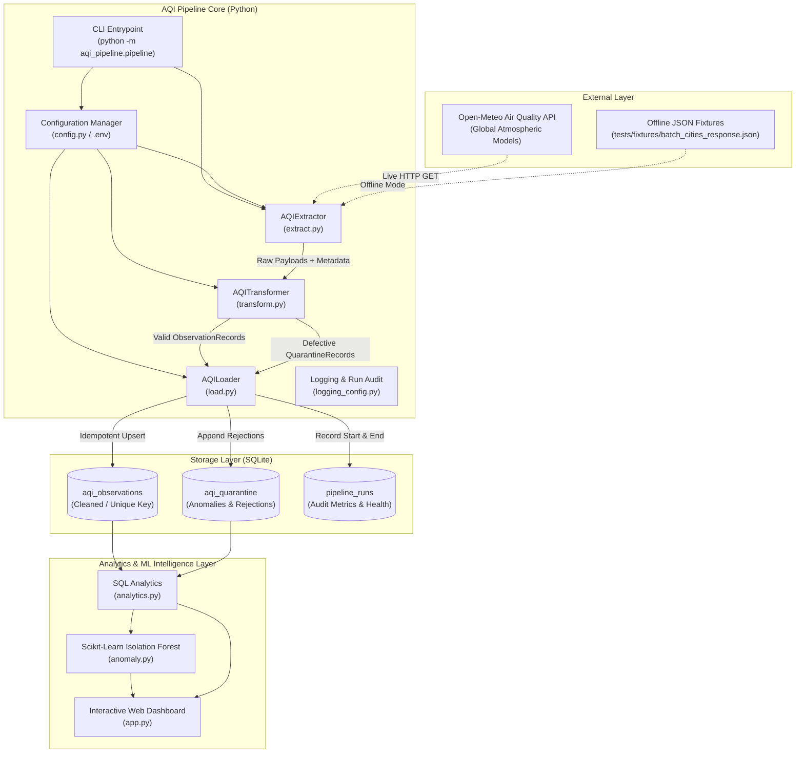
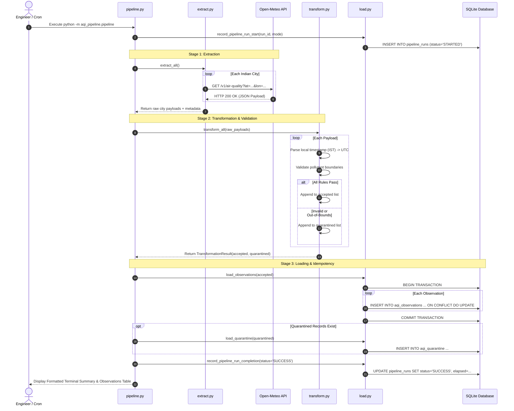
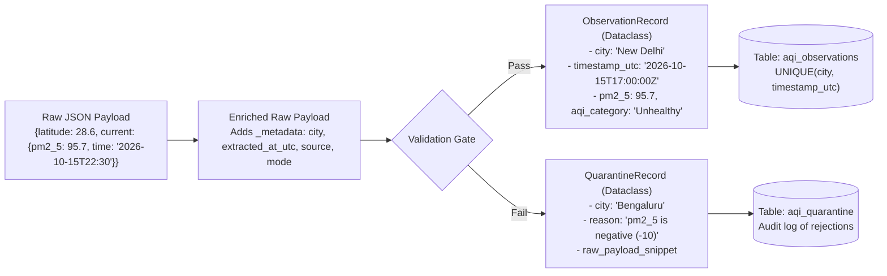
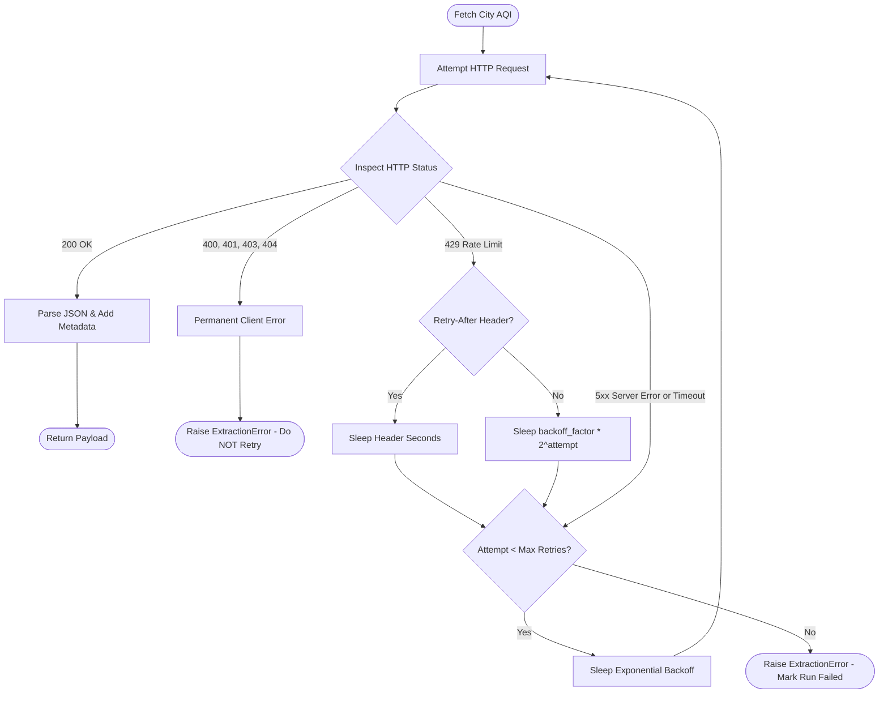
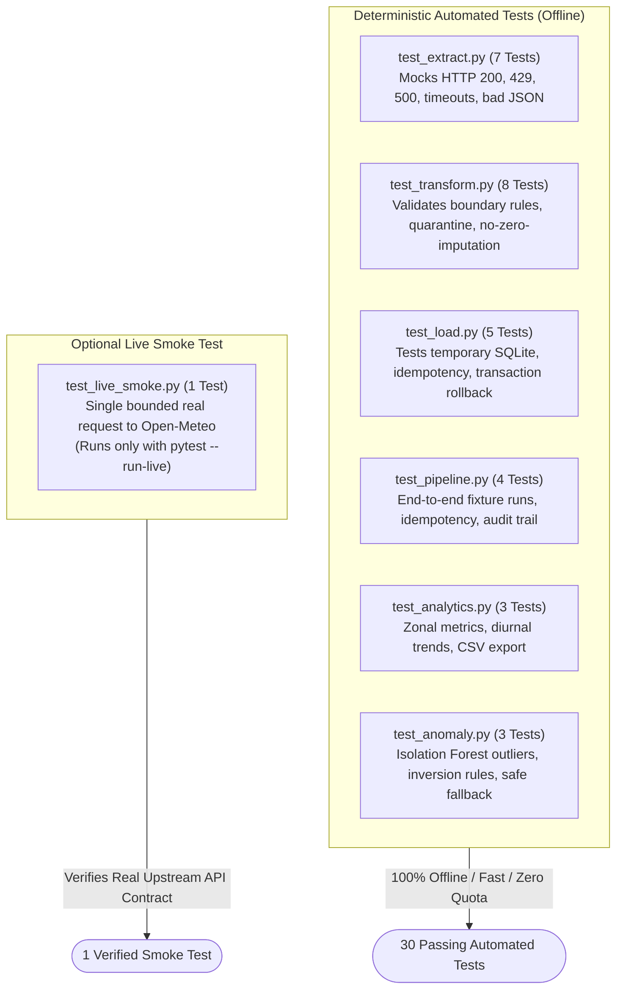

# 07 — Architecture, Diagrams & Workflow Documentation

This document contains visual Mermaid architecture diagrams and detailed narrative explanations covering data flows, execution sequences, component dependencies, and failure handling.

---

## 1. High-Level System Architecture

### Walkthrough:
The system is divided into four integrated tiers:
1. **External Layer**: Supplies air quality observations either through the live Open-Meteo REST API or offline pre-sanitized test fixtures.
2. **Pipeline Core**: A decoupled 3-stage Python architecture orchestrated by `AQIPipeline`. Configuration and structured logging wrap all operations.
3. **Storage Layer**: An embedded SQLite relational database hosting clean analytical records (`aqi_observations`), a quarantine dead-letter repository (`aqi_quarantine`), and execution run telemetry (`pipeline_runs`).
4. **Intelligence & Presentation Layer**:
   - `analytics.py`: Executes SQL queries to compute city-level aggregates, PM2.5/PM10 mass ratios, and data quality metrics.
   - `anomaly.py`: Applies an unsupervised Scikit-learn `IsolationForest` across multi-pollutant vectors to isolate sensor anomalies and physical inversions.
   - `app.py`: An interactive, dark-mode Streamlit dashboard enabling real-time geographic map exploration, trend charting, anomaly inspection, and live pipeline triggering.

---

## 2. End-to-End Sequence Diagram

---

## 3. Data Flow & Schema Evolution

---

## 4. Failure Handling & Exponential Backoff Flowchart

---

## 5. Testing Architecture

